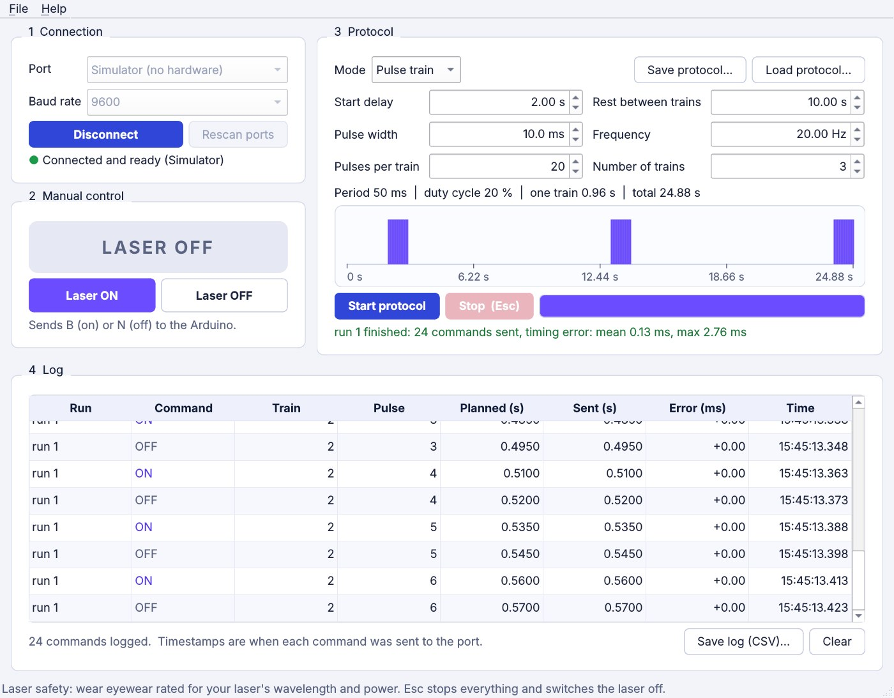
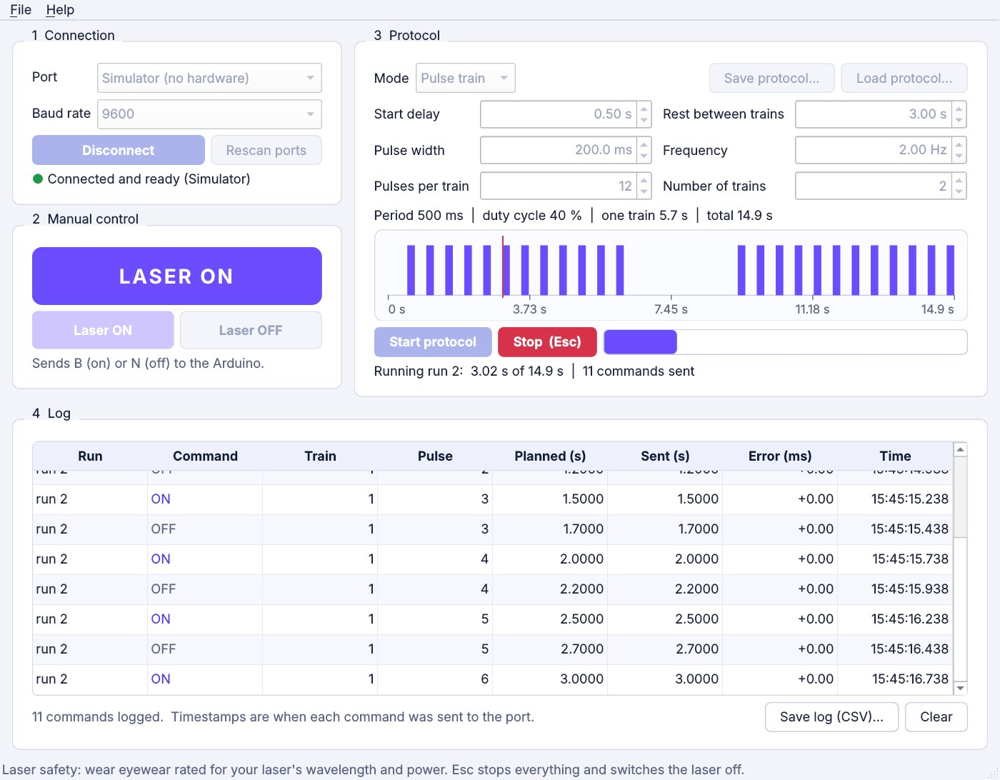
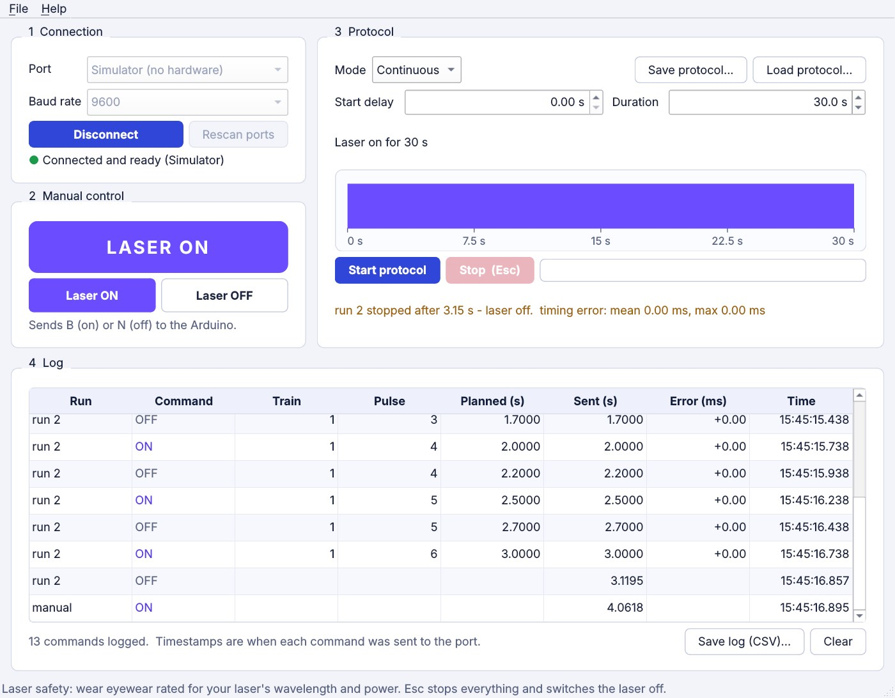
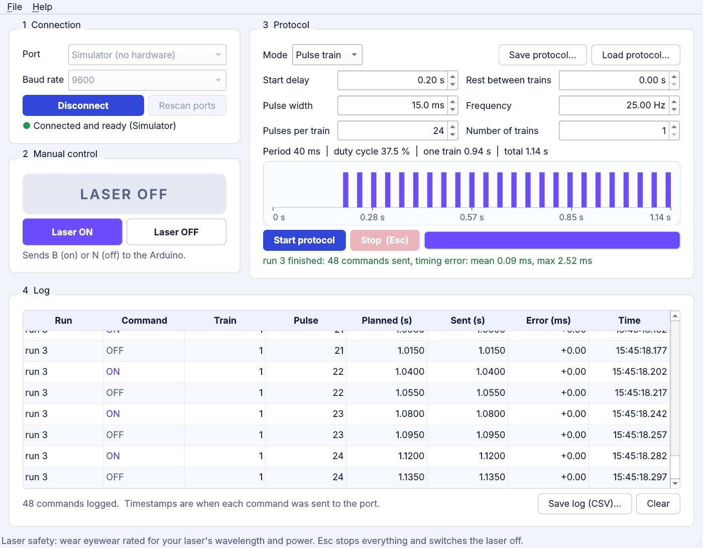
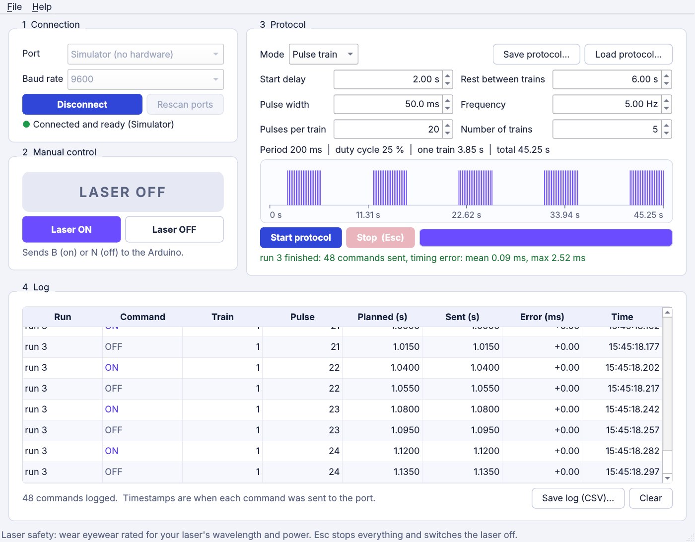

# OptoStim

Pulse-train controller for a laser (or any DC load) switched by an Arduino and a MOSFET module.
Set pulse width, frequency, number of pulses and trains, press **Start**, and OptoStim switches the
laser on and off over USB serial and logs every command with a timestamp.

It talks to the Arduino with two characters: **`B`** turns the output pin on, **`N`** turns it off.

## Screenshots











The screenshots use the built-in simulator, so they need no hardware.

## Install

Download the file for your computer from the [latest release](../../releases/latest):

| Your computer | File |
|---|---|
| Windows 10 / 11 | `OptoStim-<version>-Windows-setup.exe` |
| Mac with Apple silicon (M1 or newer) | `OptoStim-<version>-macOS-AppleSilicon.pkg` |
| Mac with an Intel processor | `OptoStim-<version>-macOS-Intel.pkg` |

The installers are not code-signed, so your system warns you the first time:

- **Windows:** in the blue "Windows protected your PC" window click **More info**, then **Run anyway**.
  The installer works per user and needs no administrator rights. It adds a Start menu entry and
  offers an optional desktop shortcut.
- **Mac:** double-click the `.pkg`. When macOS says it cannot be opened, go to
  **System Settings → Privacy & Security**, scroll down and click **Open Anyway** next to the
  OptoStim message. The app is installed into `/Applications`.

Not sure which Mac you have? Apple menu → About This Mac: "Chip: Apple M…" is Apple silicon,
"Processor: Intel…" is Intel.

## What you need besides the installer

These cannot be part of the installer:

| Part | Notes |
|---|---|
| Arduino (Uno, Nano or similar) | Upload `firmware/OptoStim_Arduino/OptoStim_Arduino.ino` once with the [Arduino IDE](https://www.arduino.cc/en/software). The IDE is only needed for this step. |
| MOSFET trigger-switch module | Switches the laser's supply voltage. |
| Laser with its own power supply | The laser's current never flows through the Arduino. |
| USB driver (clone boards only) | Boards with a CH340/CH341 chip may need the manufacturer's driver on Windows if no COM port appears. |

Wiring:

| Arduino | MOSFET module |
|---|---|
| pin 7 | trigger input `+` |
| GND | trigger input `-` |

The laser's supply goes to the module's power-in terminals and the laser to its switched output
terminals. If your laser is a bare diode without its own current-limiting driver, a MOSFET switch
alone is not enough: it only switches the supply on and off and does not limit current.

OptoStim also works without hardware: choose **Simulator (no hardware)** as the port.

## Using OptoStim

1. Plug in the Arduino, close the Arduino IDE's Serial Monitor (only one program can use the port),
   pick the port and click **Connect**. An Uno restarts when the port opens, so OptoStim waits
   about two seconds before it enables the buttons.
2. **Manual control** sends a single `B` or `N`.
3. Under **Protocol** choose a mode:
   - **Pulse train:** pulse width, frequency, pulses per train, number of trains, rest between
     trains, start delay. The summary shows period, duty cycle and total time, and the timeline
     previews exactly what will be sent.
   - **Continuous:** laser on for a set time (0 = until you press Stop).
4. **Start protocol** runs it. **Stop** or **Esc** stops immediately and switches the laser off.
5. The **log** lists every command. **Save log (CSV)** writes it for your records.
   Protocols can be saved and loaded as small `.json` files.

Safety behaviour: the laser is switched off when a protocol ends or is stopped, when you
disconnect, when the window is closed and when an error occurs. The Arduino keeps its last state
until it receives the next character, so if the Arduino has its own power supply and you unplug
USB while the laser is on, it stays on. Keep the laser's power switch within reach and wear
eyewear rated for its wavelength and power.

### Timing

Commands travel over USB serial and are timed by the computer, not the Arduino. Expect timing
errors of about a millisecond on a quiet machine and more on a busy Windows PC (the log shows the
error of every command). The timestamps in the log are when each command was **sent**, not when
the light changed. For sub-millisecond precision or fast trains (above roughly 100 Hz) drive the
MOSFET module from a hardware timer or from your stimulus computer's TTL output instead.

## Install from source

For development, or if you prefer not to use the installers. Python 3.10 or newer is needed.

- **Windows:** double-click `install_windows.bat` (uses conda if found, otherwise a `.venv`), then
  start with `start_optostim.bat` or the desktop shortcut it creates.
- **Mac:** double-click `install_mac.command`, then start with `start_optostim.command`. If macOS
  says you have no permission to run it, open Terminal in the folder and run
  `chmod +x *.command` (or run `bash install_mac.command`).
- **By hand:**

  ```
  pip install -r requirements.txt
  python -m optostim
  ```

Check that everything works with the built-in self-test, which runs a synthetic protocol on a
simulated device and on a serial loopback, then drives the whole window without a display. It
exits with code 0 on success:

```
python -m optostim --selftest
```

## Making a release

Installers are built by GitHub Actions (`.github/workflows/build-installers.yml`) on Windows,
Apple-silicon macOS and Intel macOS. The version number comes from the tag and is shown in
**Help → About OptoStim**.

**Option 1: push a tag.** Create the tag `v1.0.0` on the commit you want (GitHub Desktop:
History → right-click the commit → *Create Tag…*, or `git tag v1.0.0`), then push it (GitHub
Desktop pushes tags with the next push, or `git push origin v1.0.0`).

**Option 2: Actions → Run workflow.** Open *Actions → Build installers → Run workflow*:

- with a **version** filled in (for example `1.0.0`) it builds, tests, then creates the tag and the
  release itself;
- with the box **empty** it only builds and tests; the installers stay available as workflow
  artifacts for 14 days and no release is created.

For every platform the workflow builds the app, **runs the built app's self-test**, packs the
installer, installs it, and runs the self-test again on the installed copy. Only if all three
platforms pass does the release job attach the three files with the `gh` CLI. A broken installer
is therefore never published.

### Building locally

```
pip install -r requirements-build.txt
python packaging/set_version.py 1.0.0
pyinstaller --noconfirm --clean OptoStim.spec
dist/OptoStim/OptoStim --selftest            # Windows: dist\OptoStim\OptoStim.exe
```

`python packaging/set_version.py 0.0.0-dev` restores the development version afterwards.

## Repository layout

| Path | What it is |
|---|---|
| `optostim/` | The application (`core.py` has no GUI code and is easy to script) |
| `firmware/OptoStim_Arduino/` | Arduino sketch (`B` = on, `N` = off) |
| `OptoStim.spec` | PyInstaller build file used on all platforms |
| `packaging/` | Inno Setup script, macOS `.pkg` script, version stamping |
| `assets/` | Logo (`.png`, `.ico`, `.icns`); redraw with `tools/make_icons.py` |
| `tools/make_screenshots.py` | Regenerates `docs/screenshots/` from the simulator |
| `.github/workflows/` | The installer workflow |

## Troubleshooting

- **No port in the list:** click *Rescan ports*; on Windows check Device Manager for the COM port
  (clone boards may need a CH340 driver). On Linux add yourself to the `dialout` group.
- **"Cannot open port":** another program (often the Arduino IDE's Serial Monitor) has it.
- **Nothing happens when the laser should switch:** check that the baud rate matches the sketch
  (9600 by default) and that the trigger wires go to pin 7 and GND.

## License

MIT, see [LICENSE](LICENSE). Copyright (c) 2026 Gergely Szarka.
